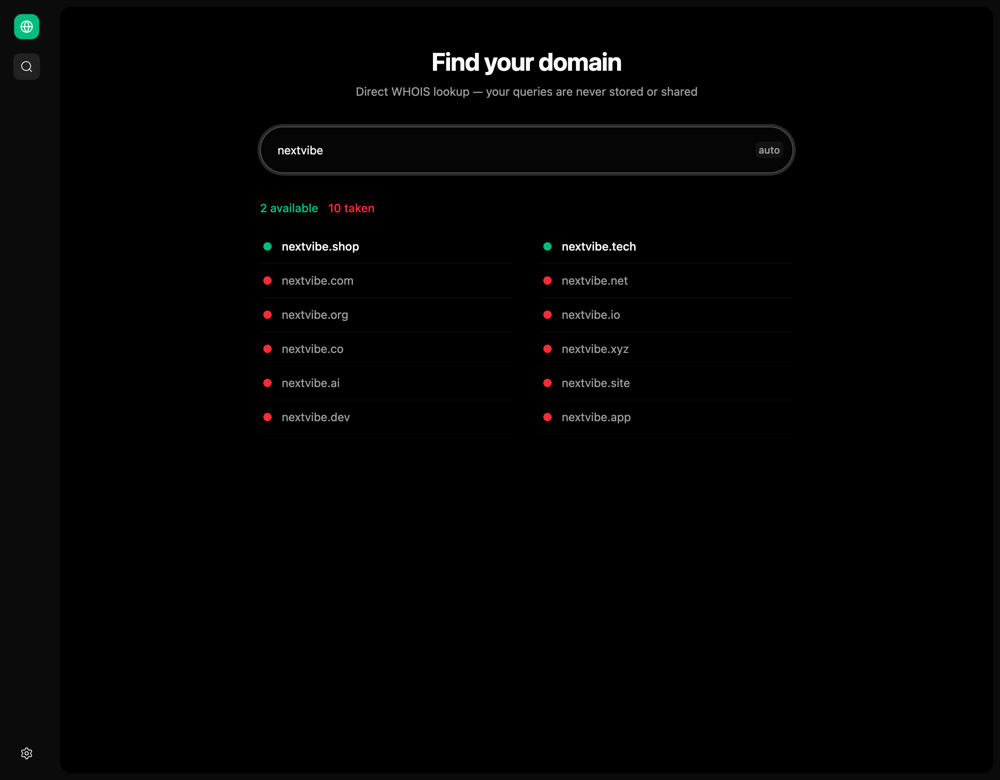

<h1 align="center" style="border-bottom: none;">Domain Checker</h1>
<h3 align="center" style="margin-top: 0; font-weight: normal;">
  Private domain availability lookup across 12 TLDs
</h3>

<p align="center">
  
</p>


<p align="center">
  <a href="https://opensource.org/licenses/mit">
    
  </a>
</p>


## What It Does

Type a domain name and instantly see availability across 12 TLDs. Lookups go directly to WHOIS/RDAP servers — your queries are never stored or shared, so there's zero risk of front-running.

**Supported TLDs:** `.com` `.net` `.org` `.io` `.dev` `.app` `.co` `.xyz` `.ai` `.shop` `.site` `.tech`

## How It Works

The backend uses a three-tier lookup strategy for authoritative results:

1. **WHOIS** (TCP port 43) — Primary method for 10 TLDs. Queries authoritative WHOIS servers directly.
2. **RDAP** (HTTP) — Used for TLDs without WHOIS servers (`.dev`, `.app`). Queries the registry's RDAP endpoint directly.
3. **DNS** (fallback) — Last resort if WHOIS/RDAP are unreachable. Queries A, AAAA, and NS. Less authoritative. `NXDOMAIN` is likely available. Any answer, including NS only, is taken. Other resolver results stay unknown.

All 12 TLDs are checked concurrently. Results are sorted with available domains first.

### UI Indicators

- **Green dot** — Available (WHOIS or RDAP confirmed). Click to copy domain to clipboard.
- **Yellow dot** — Likely available (DNS-inferred, less certain). Click to copy with "likely" label.
- **Red dot** — Taken.
- **Gray dot** — Unknown/loading.

## Quick Start

```bash
npm run install-all
npm run start
```

Frontend runs at `http://localhost:5173`, backend at `http://localhost:8000`.

## Development

```bash
npm run start             # Frontend (Vite on :5173)
npm run front             # Same as start
cd backend && cargo run   # Backend only (Rust on :8000)
npm run build             # Production frontend build
```

## Project Structure

```
domain-checker/
├── src/
│   ├── components/
│   │   └── HomeView.tsx    # Domain checker UI
│   ├── assets/
│   │   └── styles.css      # Theme overrides
│   ├── main.tsx            # Route config
│   └── constants.json      # App config
├── backend/
│   ├── src/check.rs        # WHOIS, RDAP, and DNS lookup
│   ├── src/routes.rs       # HTTP routes, including POST /api/check
│   ├── Cargo.toml          # Empty dependency list
│   └── config.json         # Backend config
├── package.json
└── vite.config.ts
```

## Tech Stack

| Technology | Purpose |
|---|---|
| React 19 | Frontend UI |
| Vite 8 | Build & dev server |
| Tailwind CSS 4 | Styling |
| skateboard-ui | Application shell framework |
| Rust (`std::net`) | Backend HTTP server, WHOIS, and DNS |
| system `curl` | RDAP lookups for `.dev` and `.app` |

## API

### `POST /api/check`

Check domain availability across all supported TLDs, or only the ones you list.

**Request body (JSON):**
- `domain` — Base domain name (alphanumeric + hyphens, max 63 chars)
- `tlds` (optional) — Array of supported TLDs to check, e.g. `["com", "ai"]`. Omit for all 12

**Response:**
```json
[
  {
    "tld": "com",
    "domain": "example.com",
    "available": false,
    "status": "taken",
    "method": "whois"
  },
  {
    "tld": "dev",
    "domain": "example.dev",
    "available": true,
    "status": "available",
    "method": "rdap"
  }
]
```

**Method values:** `whois`, `rdap`, `dns`

## Name Hunt

`scripts/hunt.mjs` finds short names that are easy to spell. It makes the names on your machine, then checks each one through `POST /api/check` with a `tlds` filter. No other service sees them.

```bash
npm run hunt -- --count 200                     # invented names, 4-5 letters, .com + .ai both free
npm run hunt -- --len 5 --require any           # print a name if any TLD is free
npm run hunt -- --source words                  # real words and first names from a local list
npm run hunt -- --seeds agent,nova --len 4-6    # blends like "novio", "agenx"
npm run hunt -- --dry-run --count 20            # print names, check nothing
```

| Flag | Default | Meaning |
|---|---|---|
| `--count` | `100` | Names to check |
| `--len` | `4-5` | Length range (`5` or `4-6`) |
| `--tlds` | `com,ai` | TLDs to check |
| `--require` | `all` | `all` TLDs free, or `any` |
| `--source` | `invented` | `invented` spellable names, or `words` from `--words` |
| `--words` | `/usr/share/dict/cracklib-small` | Word list for `--source words` |
| `--seeds` | none | Comma-separated roots to blend first |
| `--api` | `https://checker.bixbyapps.com/api/check` | Use `http://localhost:8000/api/check` for a local backend |
| `--cache` | `~/.cache/domain-checker/hunt.jsonl` | Every result, so no name is sent twice |

Invented names use letters with one obvious spelling (no c/k/q/h/j/w/y), hard `g` only before a/o/u, `s`/`z` only at the start, and end in a, o, n, r, l, or x. Calls are spaced 2.1s apart to stay under the 30/min limit. A 429 waits 61s, a 5xx backs off 2s, 4s, 8s, and 3 failed names in a row stop the run.

## License

MIT License — see [LICENSE](LICENSE) for details.

---

<div align="center">
  Made with <a href="https://github.com/stevederico/skateboard">Skateboard</a> — a React boilerplate
</div>
